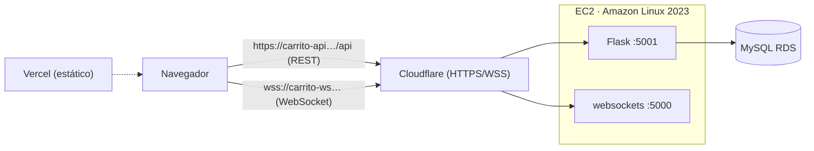

# Despliegue e Infraestructura — Carrito IoT Frontend

Documento técnico del **frontend** (React + Vite + Three.js): cómo funciona, dónde se hospeda,
cómo se conecta al backend, cómo se instala/prueba y cómo se monitorea.
Para el resumen de portafolio, ver [`README.md`](README.md) (y [`README.es.md`](README.es.md)).

> **Nota:** se usan **placeholders** (`<ELASTIC_IP>`, `<RDS_ENDPOINT>`) a propósito; los secretos
> y endpoints reales no se versionan.

---

## 1. Qué es

Panel web **single-page** (SPA) para **controlar y monitorear** el carrito IoT:

- **Control**: D‑Pad, 11 movimientos, slider de velocidad (0–255), secuencias **DEMO**.
- **Monitoreo**: dashboard + visor **3D** del carro (Three.js) + registro de eventos.
- Estética **synthwave/neón**. El carro 3D es **100% procedural** (no carga `.glb/.gltf`; la carpeta `public/Carro Modelo/` está **vacía y en desuso**).

---

## 2. Tecnologías usadas (frontend)

| Área | Tecnología |
|---|---|
| UI | **React 19** |
| Build/dev | **Vite** |
| 3D | **Three.js** + `@react-three/fiber` + `@react-three/drei` + `@react-three/cannon` |
| Iconos | `lucide-react` |
| Estilos | **CSS puro** (glassmorphism, variables CSS) |
| Gestor de paquetes | **pnpm** |
| Hosting | **Vercel** (estático) |
| DNS/HTTPS | **Cloudflare** (dominio propio) |

---

## 3. Dónde se hospeda

| Dato | Valor |
|---|---|
| Hosting | **Vercel** (build `pnpm build`, salida `dist/`) |
| URL Vercel | `https://iot-carrito-aws-frontend.vercel.app` |
| Build base | `/` (raíz) por defecto |
| GitHub Pages (alternativa) | usa `VITE_BASE=/Iot_carrito_aws_frontend/` |

---

## 4. Variables de entorno (`.env` / Vercel → Environment Variables)

| Variable | Ejemplo | Para qué |
|---|---|---|
| `VITE_API_URL` | `https://carrito-api.rodrigodvillar.com/api` | Base de la REST (**incluye `/api`**) |
| `VITE_WS_URL` | `wss://carrito-ws.rodrigodvillar.com` | WebSocket (**`wss://`**, sin path) |
| `VITE_BASE` | `/` (Vercel) · `/Iot_carrito_aws_frontend/` (Pages) | Base del build |
| `VITE_API_PROXY_TARGET` | `http://localhost:5001` | Proxy de desarrollo (opcional) |
| `VITE_DEVICE_ID` | `ESP8266-CAR-001` | Identificador del carrito (opcional) |

> ⚠️ `VITE_*` se resuelven en **build time** → **Redeploy** tras cambiarlas.
> Si `VITE_API_URL` está **vacío**, la app arranca en **modo simulado** (no llama a ningún host).

---

## 5. Cómo se conecta al backend



- **Comandos** → `POST ${VITE_API_URL}/enviar_movimiento` y `/ejecutar_demo` (REST).
- **Tiempo real a la UI** → el navegador escucha el **WebSocket** (`wss://…`); si el WS no está
  disponible, cae a **polling HTTP cada 2 s** a `/api/ultimo_movimiento`.
- **Modo LIVE vs DEMO** (capa `src/api/`): si hay `VITE_API_URL` y el *health check* (2.5 s)
  responde → **LIVE**; si no → **DEMO SIMULADA (sin hardware)** (todo en el navegador).

---

## 6. Instalación y comandos

```bash
pnpm install     # dependencias
pnpm dev         # servidor de desarrollo (por defecto modo simulado)
pnpm build       # build de producción -> dist/
pnpm preview     # sirve dist/ localmente
pnpm lint        # ESLint
```
**Deploy en Vercel:** importar el repo, framework *Vite*, definir las `VITE_*` y **Redeploy**.
**GitHub Pages (opcional):** workflow en [`.github/workflows/deploy-pages.yml`](.github/workflows/deploy-pages.yml)
(fija `VITE_BASE`).

---

## 7. Monitoreo / pruebas

```bash
# En el navegador: DevTools → Network → WS  (verás wss://carrito-ws… y frames JSON)
# Y desde tu PC:
curl.exe -s https://carrito-api.rodrigodvillar.com/api/movimientos
npx wscat -c wss://carrito-ws.rodrigodvillar.com
```
En la app: banner **`LIVE`** = conectado al backend real; **`DEMO SIMULADA`** = sin backend.

---

## 8. Solución de problemas (real)

| Síntoma | Causa | Solución |
|---|---|---|
| Página en **blanco** + 404 de `assets/…` | el build usó el base de GitHub Pages | `VITE_BASE=/` (el default ya es `/`) |
| El WS da **502** | servidor WS crudo en el backend | migrado a la librería `websockets` |
| Mixed Content (`ws://` bloqueado) | navegador en HTTPS | usar **`wss://`** (Cloudflare Tunnel) |
| Siempre **DEMO SIMULADA** | `VITE_API_URL` vacío o health check falla | revisar env + que el backend responda |
| Polling en vez de WS | WS no abre | revisar `VITE_WS_URL`/`wss` |

---

## 9. Pendientes / `[TODO_CONTENT]`
- `[TODO_CONTENT]` capturas reales en `docs/img/` y enlaces de video (`[LINK_YOUTUBE_DEMO]`, `[LINK_YOUTUBE_AWS]`).
