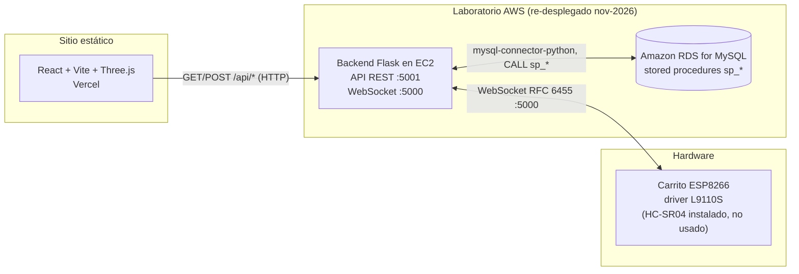

# Carrito IoT — Frontend de Control y Monitoreo

Panel web interactivo (React + Vite + Three.js) para manejar y monitorear un
carrito robot con ESP8266: 11 comandos de movimiento, control de velocidad
global (0–255), secuencias DEMO pre-grabadas y un panel de monitoreo en vivo,
todo con estética synthwave/neón y un auto renderizado en 3D en el navegador.

> **Estado (nov 2026):** este proyecto se construyó como examen del Tema 4 de
> *Implementación de soluciones IoT* (entrega original `01/06/2026`) y se
> **re-desplegó en noviembre de 2026** en un **laboratorio de AWS**. La
> infraestructura en vivo se mantendrá hasta **[CONFIRMAR fecha]**; después, la
> app cae a su **modo demo** en el navegador (`DEMO SIMULADA (sin hardware)`), que
> **nunca afirma controlar hardware físico**.

---

## Qué es y qué problema resuelve

Controlar un carrito robot por Wi-Fi suele implicar una app móvil a medida o un
sketch local desechable. Este proyecto hace lo contrario: expone el carrito a
través de un backend estándar **REST + WebSocket**, guarda cada evento en una
**base de datos relacional mediante stored procedures**, y permite manejarlo y
observarlo desde cualquier navegador.

- **Problema:** darle al carrito ESP8266 un plano de control/telemetría en la
  nube (comandos, historial, rutinas predefinidas) usable desde un navegador.
- **Solución:** un front-end React que habla con un backend Flask (REST en
  `:5001` para CRUD/polling y WebSocket nativo en `:5000` para comandos en
  tiempo real) respaldado por MySQL con stored procedures, más la visualización
  3D del auto.

---

## Arquitectura (despliegue original en AWS)



- **ESP8266 (carrito):** recibe comandos por **WebSocket nativo** (puerto `5000`).
  Cada comando lleva el PWM de ambos motores y una duración; el carrito se detiene
  al terminar la duración.
- **Backend (Flask, EC2):** API REST en `5001` para el panel web y un servidor
  WebSocket en `5000` (librería estándar **`websockets`**) para el dispositivo.
  Escala el PWM de los motores según la velocidad global y reproduce las
  secuencias DEMO respetando los retardos reales.
- **Base de datos (MySQL, RDS):** catálogo de movimientos, secuencias DEMO y su
  detalle, más movimientos/obstáculos registrados y una tabla `parametros`. Todo
  el acceso pasa por **stored procedures** (`sp_ultimo_movimiento`,
  `sp_agregar_movimiento`, `sp_crear_demo`, `sp_agregar_movimiento_a_demo`,
  `sp_repetir_demo`, …).
- **Frontend (Vercel):** este proyecto — panel de control, dashboard de monitoreo
  y el auto 3D (GitHub Pages queda como objetivo alternativo).

### Estructura del repositorio

```
src/
  App.jsx            # layout + pestañas (control / monitoreo)
  useCarControl.js   # estado + polling, consume la capa de API
  ControlPanel.jsx   # D-pad, velocidad, movimientos, botones DEMO, log de eventos
  MonitorPanel.jsx   # dashboard de monitoreo + visor 3D
  Scene3D.jsx        # escena Three.js (no modificada para la demo)
  Vehicle.jsx        # auto 3D (no modificado para la demo)
  DemoBanner.jsx     # letrero LIVE / DEMO SIMULADA
  api/               # capa de API con dos implementaciones intercambiables
    index.js         # selección de modo (real vs simulada) + health check
    realApi.js       # fetch + WebSocket a VITE_API_URL / VITE_WS_URL
    simulatedApi.js  # backend en el navegador (movimientos, demos, log)
    simulatedData.js # movimientos, PWM/tiempos y secuencias DEMO
    config.js        # configuración por variables de entorno
```

---

## Modo Demo vs. Modo Live

La app elige el modo automáticamente al iniciar:

| Condición | Modo | Letrero |
|-----------|------|---------|
| `VITE_API_URL` vacío | **Simulado** | `DEMO SIMULADA (sin hardware)` |
| `VITE_API_URL` definido **y** health check OK (~2.5 s) | **Live** | `LIVE` |
| `VITE_API_URL` definido **pero** health check falla/timeout | **Simulado** | `DEMO SIMULADA (sin hardware)` |

- **Backend simulado** (`src/api/simulatedApi.js`) reproduce el comportamiento
  original en el navegador: los 11 movimientos con sus PWM/tiempos reales, el
  escalado por velocidad global, las secuencias DEMO con sus retardos reales y un
  registro de eventos persistido en `sessionStorage` que alimenta el panel de
  monitoreo. El auto 3D se anima con esos comandos igual que con el backend real.
- **Backend real** (`src/api/realApi.js`) usa `fetch` para la API REST y un
  `WebSocket` para los envíos en tiempo real. No hay nada fijo: ambas URLs vienen
  de variables de entorno.

Ambas implementaciones comparten la misma interfaz, así que el resto de la app no
sabe cuál está activa.

---

## Cómo correrlo localmente

Requisitos: **Node.js** y **pnpm**.

```bash
pnpm install
pnpm dev        # servidor de desarrollo (modo simulado por defecto)
pnpm build      # build de producción en dist/
pnpm preview    # sirve el build de producción localmente
pnpm lint       # ESLint
```

Copia `.env.example` a `.env` para apuntar a un backend real:

```bash
VITE_API_URL=https://tu-backend.ejemplo.com/api   # vacío = modo simulado
VITE_WS_URL=wss://tu-backend.ejemplo.com          # opcional
VITE_API_PROXY_TARGET=http://localhost:5001        # proxy de desarrollo (opcional)
```

### Despliegue (Vercel principal · GitHub Pages alternativa)

**Vercel es el host principal (activo).** Importa el repo, framework *Vite*,
`pnpm build` → `dist/`, y define las variables `VITE_API_URL` y `VITE_WS_URL`.
El build usa `base: '/'` por defecto.

GitHub Pages es una **alternativa secundaria y actualmente inactiva**: hay un
workflow en [`.github/workflows/deploy-pages.yml`](.github/workflows/deploy-pages.yml)
(solo corre si Pages se activa como fuente de despliegue). Para Pages el build
necesita `VITE_BASE=/Iot_carrito_aws_frontend/`.

> **Por qué puede verse en blanco en Pages:** Pages debe servir el output
> **compilado**, no el código fuente; si no, el navegador pide `/src/main.jsx` y
> recibe un 404.

---

## Estado (honesto)

- **Re-desplegado en noviembre de 2026** (entrega original `01/06/2026`) en un
  **laboratorio de AWS**. Se mantiene hasta **[CONFIRMAR fecha]**; después la app
  cae automáticamente a **modo demo** en el navegador.
- El **firmware ESP8266 que habla WebSocket SÍ está en el repositorio del backend**:
  `ESP8266_WiFi_Robot_Car/ESP8266_WiFi_Robot_Car.ino` (rama `feat/portfolio-demo`).
- No hay suite de pruebas automatizadas configurada, por lo que no se agregó.

---

## Decisiones técnicas

- **Capa de API con dos implementaciones.** Una fachada (`src/api/index.js`) elige
  entre `realApi` y `simulatedApi` tras un health check. Así `useCarControl.js` y
  la UI no cambian según el backend activo.
- **Variables de entorno en vez de IPs fijas.** Se eliminaron los hosts del
  código; `VITE_API_URL` / `VITE_WS_URL` (vacías por defecto) definen la config.
- **Fidelidad, no simplificación, en la simulación.** Los PWM, tiempos, reglas de
  velocidad fija en giros y retardos de DEMO se copiaron del seed SQL original y
  de la lógica de Flask para que el comportamiento simulado coincida con el real.
- **Push en tiempo real + polling de respaldo.** El diseño original empujaba
  movimientos por WebSocket y hacía polling de `/api/ultimo_movimiento` cada 2 s;
  ambos se conservan, con de-duplicación para no registrar el mismo evento dos veces.
- **Escena 3D intacta.** La escena synthwave (`Scene3D`/`Vehicle`) no se modificó
  para evitar regresiones.

## Lecciones aprendidas

- **El tiempo real necesita respaldo.** WebSockets están muy bien, pero un
  fallback por polling mantuvo la UI consistente cuando el socket se caía.
- **Separar el hardware de la UI.** Centralizar "cómo hablamos con el backend" en
  una capa de API permitió cambiar un backend muerto por una simulación sin tocar
  los componentes.
- **La configuración no debe vivir en el código.** Los hosts/credenciales fijos
  dejaron el proyecto inutilizable cuando cerró el laboratorio.
- **Hay que ser honesto con lo que es una demo.** Una demo de portafolio debe
  decir claramente que simula hardware, no dar a entender que controla hardware real.

## Roadmap

- **Rehospedar tras el laboratorio AWS.** Cuando caduque el laboratorio,
  reemplazar el EC2+RDS por un despliegue serverless pequeño con **polling** de
  estado (dejando el servidor WebSocket por HTTP simple + polling corto).
- **Postgres serverless.** Mover el esquema y los stored procedures a un Postgres
  serverless (p. ej. Neon/Supabase) y migrar la lógica que vivía en las consultas
  del backend Flask.
- **Contenido por capturar.** `[TODO_CONTENT]`: capturas del panel de control y
  del dashboard de monitoreo, y un video corto de la demo.

---

## Capturas y video

| Vista | Descripción |
|---|---|
|  | Panel de control + auto 3D (portada, 16:10) |
|  | Hardware del carrito ESP8266 |
|  | Manejando el carrito desde el navegador |

- Video de la demo: [LINK_YOUTUBE_DEMO]
- Recorrido de la arquitectura AWS: [LINK_YOUTUBE_AWS]

## Código fuente

- Frontend: `https://github.com/Villa19d/Iot_carrito_aws_frontend`
- Backend: `https://github.com/Villa19d/Iot_carrito_aws_backend`

## Licencia

MIT — ver [`LICENSE`](LICENSE).


---

## ⚠️ Limitaciones (demo, no producción)

- **Sin autenticación:** la API no valida usuarios ni tokens; cualquiera con la URL
  podría enviar comandos al carro.
- **Exposición de puertos:** el Security Group abre **5000/5001**. Recomendado:
  **cerrar el 5001** (el navegador usa el Cloudflare Tunnel) y dejar el **5000**
  solo para el ESP8266.
- **No apto para producción:** Flask en modo desarrollo + `websockets`, sin TLS
  propio (el TLS lo aporta Cloudflare Tunnel).
- El carro físico se mantiene **desconectado** salvo durante las grabaciones.

