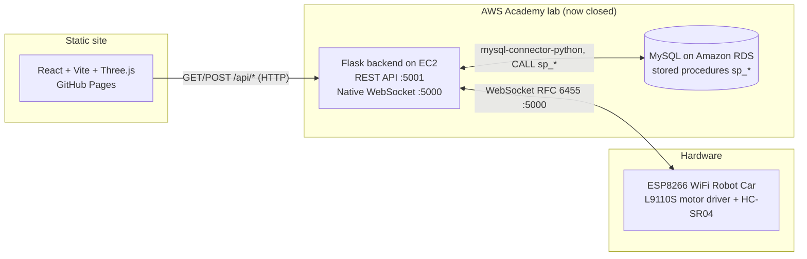

# Carrito IoT — Control & Monitoring Frontend

An interactive web panel (React + Vite + Three.js) to drive and monitor an
ESP8266 WiFi robot car: 11 movement commands, a global speed slider (0–255),
pre-recorded DEMO sequences and a live monitoring dashboard, all wrapped in a
synthwave/neon aesthetic with a 3D car rendered in the browser.

> **Important:** this project was built as the Tema 4 exam of the *IoT Solutions
> Implementation* course. The original backend ran on a temporary **AWS Academy**
> lab that has since been **closed**, so the real AWS endpoints no longer exist.
> To keep the project demonstrable, the app now ships with a **fully in-browser
> simulated backend**. When no real backend is configured, the app clearly shows
> `DEMO SIMULADA (sin hardware)` and **never claims to control physical hardware**.

---

## What it is and what problem it solves

Controlling a small robot car over Wi-Fi usually means a custom mobile app or a
throw-away local sketch. This project does the opposite: it exposes the car
through a standard **REST + WebSocket** backend, stores every event in a
**relational database through stored procedures**, and lets a normal browser
drive and observe it.

- **Problem:** give an ESP8266 car a proper cloud control/telemetry plane
  (commands, history, canned routines) that any device with a browser can use.
- **Solution:** a React front-end that talks to a Flask backend (REST on `:5001`
  for CRUD/polling, native WebSocket on `:5000` for real-time commands) backed by
  a MySQL database with stored procedures, plus a 3D visualisation of the car.

---

## Architecture (original AWS deployment)



- **ESP8266 (car):** receives commands over a **native WebSocket** (port `5000`).
  Each command carries the PWM of both motors and a duration; the car stops when
  the duration elapses.
- **Backend (Flask, EC2):** REST API on `5001` for the web panel and a
  hand-rolled native WebSocket server on `5000` for the device. It scales motor
  PWM by the global speed and replays DEMO sequences respecting real delays.
- **Database (MySQL, RDS):** catalog of movements, demo sequences and their
  detail, plus registered movements/obstacles and a `parametros` table. All
  access goes through **stored procedures** (`sp_ultimo_movimiento`,
  `sp_agregar_movimiento`, `sp_crear_demo`, `sp_agregar_movimiento_a_demo`,
  `sp_repetir_demo`, …).
- **Frontend (GitHub Pages):** this project — control panel, monitoring
  dashboard and the 3D car.

### Repository layout

```
src/
  App.jsx            # layout + tabs (control / monitoring)
  useCarControl.js   # state + polling, consumes the API layer
  ControlPanel.jsx   # D-pad, speed slider, movements, DEMO buttons, event log
  MonitorPanel.jsx   # monitoring dashboard + 3D viewer
  Scene3D.jsx        # Three.js scene (not modified for the demo)
  Vehicle.jsx        # 3D car (not modified for the demo)
  DemoBanner.jsx     # LIVE / DEMO SIMULADA banner
  api/               # API layer with two interchangeable implementations
    index.js         # mode selection (real vs simulated) + health check
    realApi.js       # fetch + WebSocket to VITE_API_URL / VITE_WS_URL
    simulatedApi.js  # in-browser backend (movements, demos, event log)
    simulatedData.js # movements, PWM/timings and DEMO sequences
    config.js        # env-var driven configuration
```

---

## Demo mode vs. Live mode

The app picks a mode automatically at start-up:

| Condition | Mode | Banner |
|-----------|------|--------|
| `VITE_API_URL` is empty | **Simulated** | `DEMO SIMULADA (sin hardware)` |
| `VITE_API_URL` set **and** health check OK (~2.5 s) | **Live** | `LIVE` |
| `VITE_API_URL` set **but** health check fails/timeout | **Simulated** | `DEMO SIMULADA (sin hardware)` |

- **Simulated backend** (`src/api/simulatedApi.js`) reproduces the original
  behaviour in the browser: the 11 movements with their real PWM/timings, the
  global speed scaling, the DEMO sequences with their real delays, and an event
  log persisted in `sessionStorage` that feeds the monitoring panel. The 3D car
  animates from those commands exactly as it did with the real backend.
- **Real backend** (`src/api/realApi.js`) uses `fetch` for the REST API and a
  `WebSocket` for real-time pushes. Nothing is hard-coded: both URLs come from
  environment variables.

Both implementations share the same interface, so the rest of the app is
agnostic to which one is active.

---

## Running locally

Requirements: **Node.js** and **pnpm**.

```bash
pnpm install
pnpm dev        # start the dev server (simulated mode by default)
pnpm build      # production build into dist/
pnpm preview    # serve the production build locally
pnpm lint       # ESLint
```

Copy `.env.example` to `.env` to point the app at a real backend:

```bash
VITE_API_URL=https://your-backend.example.com/api   # leave empty for simulated mode
VITE_WS_URL=wss://your-backend.example.com          # optional
VITE_API_PROXY_TARGET=http://localhost:5001         # optional dev proxy
```

### Deployment (GitHub Pages)

The build uses `base: '/Iot_carrito_aws_frontend/'` so it works under the GitHub
Pages project URL.

Deployment is automated with GitHub Actions
([`.github/workflows/deploy-pages.yml`](.github/workflows/deploy-pages.yml)):
every push/merge to `main` builds the app and publishes the compiled `dist/` to
Pages.

**One-time setup:** repository `Settings > Pages > Build and deployment >
Source = "GitHub Actions"`.

> **Why the page can appear blank:** Pages must serve the **compiled** output,
> not the repository source. If Pages is set to serve the `main` branch root, the
> browser requests `/src/main.jsx`, gets a 404 and the page stays blank.
> Deploying the built `dist/` (as this workflow does) fixes it.
>
> **Manual fallback** (branch-based Pages): run `pnpm build` then
> `pnpm dlx gh-pages -d dist`, and set `Settings > Pages > Source` to the
> `gh-pages` branch.

---

## Status (honest)

- The **AWS Academy lab is closed**. The EC2 backend and RDS database are gone,
  so `LIVE` mode has nothing to connect to unless a backend is re-deployed.
- The app therefore runs in **simulated mode** by default and says so clearly.
- The **ESP8266 firmware that speaks WebSocket is not in this repository** — the
  `.ino` in the project folder is the vendor example (plain HTTP over a Wi-Fi
  access point). `[TODO_CONTENT]`: link to the WebSocket firmware sketch.
- No automated test suite is configured in this repository, so none was added.

---

## Technical decisions

- **API layer with two implementations.** A single facade (`src/api/index.js`)
  chooses between `realApi` and `simulatedApi` after a health check. This keeps
  `useCarControl.js` and the UI unchanged regardless of the active backend.
- **Env vars instead of hard-coded IPs.** All backend hosts were removed from the
  code; `VITE_API_URL` / `VITE_WS_URL` (empty by default) drive configuration.
- **Fidelity over simplification in the simulation.** PWM values, timings,
  fixed-turn speed rules and DEMO delays were copied from the original SQL seed
  and Flask logic so the simulated behaviour matches the real one.
- **Realtime push + polling fallback.** The original design pushed movements over
  WebSocket and polled `/api/ultimo_movimiento` every 2 s as a fallback; both are
  preserved, with de-duplication so the same event is not logged twice.
- **3D scene left untouched.** The synthwave scene (`Scene3D`/`Vehicle`) was not
  modified for the demo to avoid regressions.

## Lessons learned

- **Real-time IoT needs a fallback.** WebSockets are great, but a polling
  fallback kept the UI consistent when the socket dropped.
- **Keep hardware concerns out of the UI.** Centralising the "how do we talk to
  the backend" logic in an API layer made it trivial to swap a dead backend for a
  simulation without touching components.
- **Configuration must not live in code.** Hard-coded hosts/credentials made the
  project unusable once the lab closed.
- **State the truth about what a demo is.** A portfolio demo must be explicit
  that it simulates hardware, not imply real control.

## Roadmap

- **Rehost without AWS Academy.** Replace the closed EC2+RDS with a small
  serverless deployment and **polling** for status (dropping the custom native
  WebSocket server in favour of plain HTTP + short polling).
- **Postgres serverless.** Move the schema and stored procedures to a
  serverless Postgres (e.g. Neon/Supabase) and migrate the logic that lived in
  the Flask SQL calls.
- **Content to capture.** `[TODO_CONTENT]`: screenshots of the control panel and
  the monitoring dashboard, and a short demo video.

---

## Screenshots & video

- Control panel screenshot: `[TODO_CONTENT]` (16:10, see `../PORTFOLIO_ENTRY.md`)
- Monitoring dashboard screenshot: `[TODO_CONTENT]`
- Demo video: `[TODO_CONTENT]`

## Source

- Frontend: `https://github.com/Villa19d/Iot_carrito_aws_frontend`
- Backend: `https://github.com/Villa19d/Iot_carrito_aws_backend`

## License

`[TODO_CONTENT]` — no license file is present in the repository.

