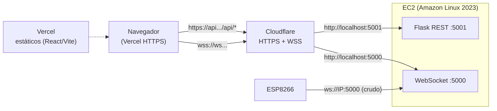

# Desplegar el frontend en Vercel + Cloudflare Tunnel en la EC2

Objetivo: servir el frontend desde **Vercel (HTTPS)** y acceder a la EC2
(REST 5001 + WebSocket 5000) **de forma segura**, evitando el bloqueo de
*Mixed Content* del navegador y consiguiendo **WebSocket real (`wss://`)**.

## Arquitectura



> Regla de oro: **no importa** dónde hospedes el front (Vercel, Netlify,
> GitHub Pages). Todos sirven **HTTPS**, y el navegador **bloquea `ws://`**.
> Necesitas **`wss://`** del lado del backend. Eso lo resuelve el túnel.

---

## Parte A — Cloudflare Tunnel en la EC2 (da `https://` y `wss://` gratis)

### A.0 Requisito
- Backend corriendo: `sudo systemctl status carrito-api` → `active (running)`.
- (Recomendado) **Elastic IP** en la EC2 para que la IP no cambie.

### A.1 Instalar cloudflared
```bash
sudo dnf install -y https://github.com/cloudflare/cloudflared/releases/latest/download/cloudflared-linux-x86_64.rpm
cloudflared --version
```

### A.2 Opción "demo rápida" — Quick Tunnel ($0, SIN dominio, URL efímera)
```bash
# Terminal 1: túnel para la REST (5001)
cloudflared tunnel --url http://localhost:5001
# Terminal 2: túnel para el WebSocket (5000)
cloudflared tunnel --url http://localhost:5000
```
Cada uno imprime una URL tipo `https://<algo>.trycloudflare.com`.
- `VITE_API_URL=https://<REST>.trycloudflare.com/api`
- `VITE_WS_URL=wss://<WS>.trycloudflare.com`
> ⚠️ La URL **cambia cada reinicio** y Cloudflare las marca *not for
> production*. Sirven para una demo/entrevista, no para un enlace fijo.

### A.3 Opción "estable" — Named Tunnel (requiere un **dominio en Cloudflare**)
```bash
# 1) Autenticar (abre una URL en el navegador)
cloudflared tunnel login

# 2) Crear el túnel
cloudflared tunnel create carrito-iot        # guarda un <UUID>.json en ~/.cloudflared/

# 3) Apuntar dos subdominios al túnel
cloudflared tunnel route dns carrito-iot api.TUDOMINIO.com
cloudflared tunnel route dns carrito-iot ws.TUDOMINIO.com

# 4) Config del túnel (como root, para el servicio systemd)
sudo mkdir -p /etc/cloudflared
sudo cp ~/.cloudflared/<UUID>.json /etc/cloudflared/
sudo tee /etc/cloudflared/config.yml >/dev/null <<'EOF'
tunnel: carrito-iot
credentials-file: /etc/cloudflared/<UUID>.json
ingress:
  - hostname: api.TUDOMINIO.com
    service: http://localhost:5001
  - hostname: ws.TUDOMINIO.com
    service: http://localhost:5000
  - service: http_status:404
EOF

# 5) Instalar y arrancar como servicio
sudo cloudflared service install
sudo systemctl enable --now cloudflared
sudo systemctl status cloudflared --no-pager
```
Resultado:
- `VITE_API_URL=https://api.TUDOMINIO.com/api`
- `VITE_WS_URL=wss://ws.TUDOMINIO.com`
- Y **ya no necesitas abrir 5000/5001** al público (excepto el 5000 para el ESP).

### A.4 Alternativa $0 y estable — DuckDNS + Caddy
Si no quieres pagar dominio pero sí URL fija: crea `xxxx.duckdns.org` (gratis,
apuntando a tu Elastic IP) y usa **Caddy** en la EC2 para HTTPS automático
(Let's Encrypt) con dos hostnames → `reverse_proxy localhost:5001` y
`reverse_proxy localhost:5000`. (Caddy binario estático + un unit systemd;
requiere 80/443 abiertos). [TODO_CONTENT: dejar los comandos exactos si eliges esta ruta]

---

## Parte B — Frontend en Vercel

1. Vercel → **Add New… → Project → Import** el repo
   `Villa19d/Iot_carrito_aws_frontend` (o el que corresponda).
2. Framework preset: **Vite**. Build: `pnpm build`. Output: `dist`.
3. **Settings → Environment Variables** (Production + Preview):
   ```
   VITE_API_URL = https://api.TUDOMINIO.com/api     # o el de Quick Tunnel
   VITE_WS_URL  = wss://ws.TUDOMINIO.com            # o el de Quick Tunnel
   VITE_BASE    = /
   ```
   > `VITE_API_URL` y `VITE_WS_URL` se leen en **build time** → hay que
   > **redeploy** cada vez que cambian.
4. **Deploy**.

Con esto:
- El *health check* (`GET ${VITE_API_URL}/movimientos`) debe dar **200** → el
  banner pasa a **`LIVE`**.
- El WebSocket abre por **`wss://`** → la animación 3D es **en vivo**.
- Si el WS no abriera, la app cae sola al **polling cada 2 s** (nunca queda en
  blanco).

> No hace falta `vercel.json` ni rewrites con esta arquitectura (el navegador
> habla directo con el túnel). Si prefieres la ruta **sin túnel** (solo REST),
> entonces sí: rewrite `/api/:path*` → `http://<ElasticIP>:5001/api/:path*` y
> `VITE_WS_URL` vacío (solo polling).

---

## Parte C — ESP8266

El firmware **no cambia**: sigue conectándose al socket crudo
`ws://<ElasticIP>:5000`. Por eso conviene **mantener el puerto 5000 abierto**
(en el Security Group, idealmente restringido) además del túnel para el
navegador. (Si algún día quieres TLS también en el ESP, habría que usar
`wss://` en el micro, que es más pesado.)

---

## Verificación

```bash
# En la EC2 (túnel estable)
curl -s https://api.TUDOMINIO.com/api/movimientos      # 11 movimientos
sudo journalctl -u cloudflared -n 20 --no-pager

# Desde tu PC / navegador
https://TU-APP.vercel.app                              # banner LIVE
# En DevTools → Network → WS: debe haber una conexión wss:// con frames JSON
```

| Prueba | Éxito |
|---|---|
| Banner muestra `LIVE` | health check OK (REST por https) |
| DevTools › Network › WS | conexión **wss://** con frames `{"success":true,...}` |
| Mover el auto con botones | el 3D reacciona en < 1 s (WS) o ≤ 2 s (polling) |

## Costos y seguridad
- **Vercel Hobby**: $0 para este front estático (verifica los límites actuales).
- **Cloudflare Tunnel**: $0 (el dominio, si lo usas, se paga aparte).
- **EC2/RDS**: coste normal de AWS (24/7).
- Con el túnel, **cierra 5001** al público; deja **5000** solo para el ESP
  (restringido por IP si puedes).

## Nota honesta
- **Vercel NO puede proxiar WebSockets** ni hospedarlos: por eso el `wss://`
  sale del túnel (Cloudflare), no de Vercel.
- Un **Quick Tunnel** funciona ya, pero su URL es **efímera**; para un enlace de
  portafolio fijo necesitas **dominio** (Cloudflare) o **DuckDNS + Caddy**.

